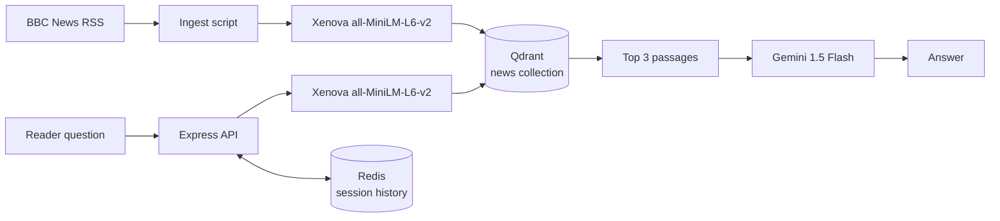

# News Chatbot — backend

An early prototype of a retrieval-augmented news assistant: an Express API that embeds a reader's question, searches a Qdrant collection of BBC News snippets, and asks Gemini for an answer.

> **Status: legacy prototype.** This repository is kept for reference. The production version of the idea is **[Dispatch](https://dispatch.kp489292.workers.dev)** — an editorial newsroom desk built on Cloudflare Workers, Workers AI, Vectorize and D1. Dispatch is live and needs no external API keys.
>
> **Live app:** <https://dispatch.kp489292.workers.dev>  
> **Current source:** <https://github.com/mundrukrishnaprasad/dispatch>

## What it does

1. **Ingest** — `src/ingest.js` fetches the BBC News RSS feed, splits each item into 50-word chunks and embeds them locally with `Xenova/all-MiniLM-L6-v2` (384 dimensions).
2. **Store** — the vectors and `{ title, url, text }` payloads are written to a Qdrant collection named `news`.
3. **Ask** — `POST /api/session/:id/message` embeds the question with the same model, retrieves the three closest chunks and builds a prompt.
4. **Answer** — Gemini 1.5 Flash answers in three to four sentences and is asked to cite titles or URLs. If Gemini fails, the service falls back to returning the retrieved snippets directly.
5. **Remember** — sessions and message history live in Redis lists under `session:<id>:history`.

## Architecture



| Component | Technology | Role |
| --- | --- | --- |
| API | Express 5 + Node.js | REST endpoints and health check |
| Streaming | Socket.IO | Word-by-word demo stream on the socket channel |
| Embeddings | `@xenova/transformers` | Local `all-MiniLM-L6-v2`, 384 dimensions |
| Vector store | Qdrant | `news` collection, cosine distance |
| Generation | Google Gemini | `gemini-1.5-flash` |
| Session store | Redis | Chat history per session |

## Endpoints

| Method | Path | Purpose |
| --- | --- | --- |
| `GET` | `/api/health` | Health check |
| `POST` | `/api/session` | Create a session |
| `POST` | `/api/session/:id/reset` | Clear a session's history |
| `POST` | `/api/session/:id/message` | `{ "message": "..." }` → `{ "reply": "..." }` |
| `GET` | `/api/session/:id/history` | Full message history |

## Running locally

Requirements: Node.js 20+, a running Qdrant instance, a running Redis instance, and a Gemini API key.

```bash
npm install
```

Create a `.env` file:

```env
PORT=5000
QDRANT_URL=http://localhost:6333
REDIS_URL=redis://localhost:6379
GEMINI_API_KEY=your-key
```

Build the vector collection once:

```bash
node src/ingest.js
```

Start the API:

```bash
npm run dev
```

The server listens on <http://localhost:5000>.

## Why the prototype was replaced

The prototype depends on three external services (Qdrant, Redis and Gemini) and local embedding models. Dispatch removes that operational overhead by using Cloudflare's native AI, vector and database bindings, streams answers with citations, and runs on a single Worker with a static front end.

## License

ISC
